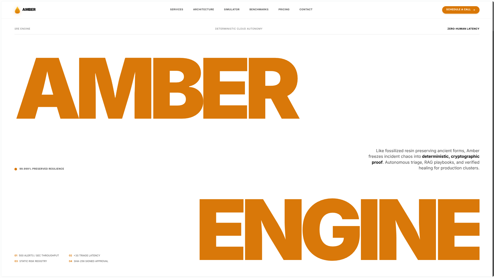
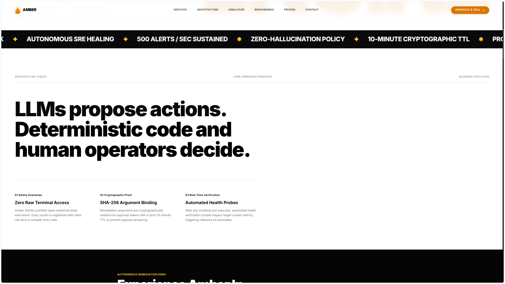
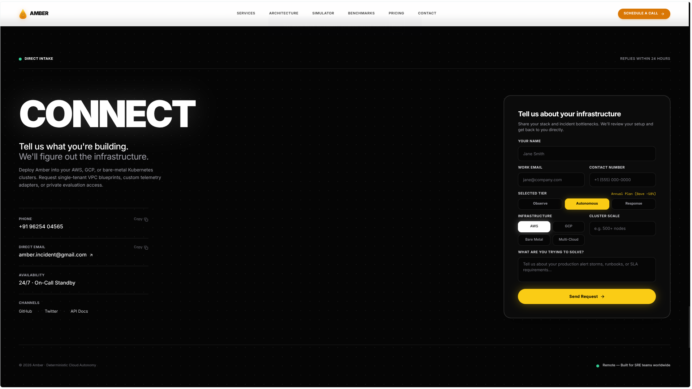

# Amber — Autonomous SRE & Incident Remediation Engine

<div align="center">
  
</div>

<p align="center">
  <b>Deterministic Cloud Autonomy.</b><br />
  Autonomous triage, hybrid RAG playbooks, and verified healing for production Kubernetes and cloud clusters.
</p>

<p align="center">
  <a href="https://github.com/himanshu-xyz-1/Amber-Frontend/stargazers"></a>
  <a href="https://github.com/himanshu-xyz-1/Amber-Frontend/blob/main/LICENSE"></a>
  <a href="https://react.dev/"></a>
  <a href="https://vite.dev/"></a>
  <a href="https://tailwindcss.com/"></a>
</p>

---

## Overview

Amber is an autonomous incident remediation engine designed for high-throughput SRE and platform engineering teams. This repository contains the public web interface, interactive alert storm simulator, architecture showcase, and serverless intake dispatch engine.

The core premise of Amber is straightforward:
> **LLMs propose actions. Deterministic code and human operators decide.**

Amber eliminates hallucination risk by enforcing static compiled tool allowlists, SHA-256 cryptographic argument binding, automated health probes, and instant auto-rollback on anomalous metrics.

---

## Architecture Thesis

<div align="center">
  
</div>

- **Zero Raw Terminal Access:** Amber prohibits unconstrained shell execution. Every action is registered with static risk levels compiled into code.
- **SHA-256 Argument Binding:** Remediation parameters are cryptographically hashed into approval tokens with strict 10-minute TTLs to prevent payload tampering.
- **Automated Health Probes:** Post-remediation canary probes verify target cluster error rates and latency. If metrics do not normalize within 10 seconds, changes revert automatically.
- **500 Alerts/sec Sustained Ingestion:** Sliding window deduplication fingerprints incident cascades before invoking agent reasoning nodes.

---

## Direct Intake & Serverless Dispatch

<div align="center">
  
</div>

The intake interface connects prospective enterprise customers directly with Amber engineers without intermediate CRM bloat:

- **Serverless API Route (`api/contact.js`):** Edge-deployed Node.js function designed for Vercel.
- **Direct `Reply-To` Header Routing:** Notifications route to `amber.incident@gmail.com` with the submitter's verified work email populated in the `Reply-To` header, allowing instant 1-click email replies without manual copying.
- **Zero Exposed Credentials:** Credentials use environment variables (`GMAIL_USER`, `GMAIL_APP_PASSWORD`), keeping client-side code completely free of sensitive secrets.
- **Local Development Simulation:** `vite.config.ts` includes an integrated development middleware that intercepts `/api/contact` locally, logging simulated dispatches when credentials are not configured.

---

## Tech Stack

| Layer | Technology | Purpose |
| :--- | :--- | :--- |
| **Framework** | React 19 + TypeScript | Core component architecture |
| **Bundler** | Vite 6 | Fast HMR and optimized production bundling |
| **Styling** | Tailwind CSS 3.4 | Custom warm amber (`#FAF8F5`) and obsidian design system |
| **Motion & Scroll** | GSAP 3 + Lenis | Smooth scrolling and timeline scrubbing |
| **Icons** | Lucide React | Clean, scalable system iconography |
| **Backend / API** | Vercel Serverless Functions (`api/contact.js`) | Direct Gmail SMTP lead dispatch |

---

## Project Structure

```
Amber-Frontend/
├── api/
│   └── contact.js                # Vercel serverless function (Gmail SMTP + Reply-To)
├── assets/                       # High-resolution screenshots for documentation
│   ├── hero-section.png
│   ├── architecture-thesis.png
│   └── connect-intake.png
├── public/
│   ├── assets/                   # Static branding logos and SVGs
│   ├── docs/                     # Terms of Service & Privacy Policy
│   └── favicon.svg
├── src/
│   ├── components/
│   │   ├── AnimatedCounter.tsx    # Live telemetry counter with unmount cleanup
│   │   ├── RemediationVideoPlayer.tsx # Interactive incident channel simulation
│   │   └── SpotlightCard.tsx     # Cursor-tracking spotlight card component
│   ├── App.tsx                   # Master page layout & state management
│   ├── index.css                 # Custom scrollbar, amber utilities & typography
│   └── main.tsx                  # React DOM entry point
├── .env.example                  # Environment variable reference
├── package.json
├── tailwind.config.js
└── vite.config.ts                # Vite config with local /api/contact middleware
```

---

## Quickstart

### 1. Clone the repository
```bash
git clone https://github.com/himanshu-xyz-1/Amber-Frontend.git
cd Amber-Frontend
```

### 2. Install dependencies
```bash
npm install
```

### 3. Configure environment variables (Optional for local testing)
Copy the template configuration:
```bash
cp .env.example .env
```

To enable live email delivery on form submissions, supply your 16-character Google App Password:
```env
GMAIL_USER=amber.incident@gmail.com
GMAIL_APP_PASSWORD=your_16_char_app_password
```
*(If left blank, form submissions run in dev simulation mode and log lead payloads to the console without failing).*

### 4. Run the development server
```bash
npm run dev
```
Open [http://localhost:3000](http://localhost:3000) in your browser.

### 5. Build for production
```bash
npm run build
```
Generates production-optimized static assets in `dist/`.

---

## Deploying to Vercel

1. Push your repository to GitHub.
2. Import the project into the [Vercel Dashboard](https://vercel.com/new).
3. Under **Project Settings → Environment Variables**, add:
   - `GMAIL_USER` = `amber.incident@gmail.com`
   - `GMAIL_APP_PASSWORD` = `<your-16-char-google-app-password>`
4. Click **Deploy**. Vercel will automatically build the React application and deploy `api/contact.js` as a serverless function.

---

## Contact & Enterprise Access

- **Direct Email:** [amber.incident@gmail.com](mailto:amber.incident@gmail.com)
- **Phone / WhatsApp:** +91 96254 04565
- **Availability:** 24/7 · On-Call Standby
- **Location:** Remote — Built for SRE teams worldwide

---

## License

MIT License. See [LICENSE](LICENSE) for details.
